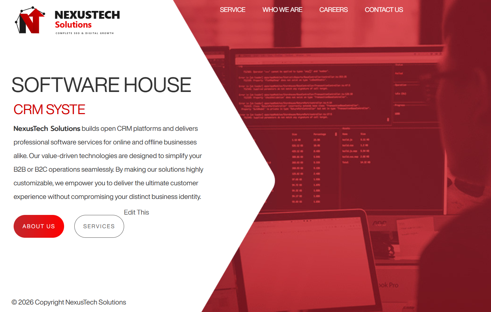

# corporate-wp-theme

Custom WordPress theme for corporate websites, built with PHP, a modular structure, and responsive design.

**Demo:** [https://api-nexustech.nichesite.org/](https://api-nexustech.nichesite.org/)



## Features

- Custom theme built from scratch (no page builder)
- Modular template structure (`template-parts/`, `inc/`)
- Responsive, mobile-first layout
- Custom post types and custom fields
- SEO-friendly markup and metadata
- Optimized asset loading for performance
- Ready for headless use via the WordPress REST API

## Tech Stack

- PHP 8+
- WordPress 6+
- HTML5, CSS3 (Sass/Tailwind), JavaScript (ES6)
- Composer / npm (optional, for build tools)

## Requirements

- WordPress 6.0 or higher
- PHP 8.0 or higher
- MySQL 5.7+ / MariaDB 10.3+

## Installation

1. Download or clone this repository into your themes folder:

   ```bash
   cd wp-content/themes
   git clone https://github.com/sama045/corporate-wp-theme.git
   ```

2. Go to **Appearance → Themes** in the WordPress admin and activate **Corporate WP Theme**.

3. (Optional) Install build dependencies:

   ```bash
   npm install
   npm run build
   ```

## Folder Structure

```
corporate-wp-theme/
├── assets/            # CSS, JS, images, fonts
├── inc/               # Theme functions, hooks, custom post types
├── template-parts/    # Reusable template components
├── functions.php
├── header.php
├── footer.php
├── index.php
├── style.css
└── screenshot.png
```

## Customization

- Menus: **Appearance → Menus** (primary, footer)
- Theme options and colors: edit `inc/` or CSS variables in `assets/css`
- Child theme recommended for custom changes

## Notes

This theme is a template adapted from real-world project experience. All client-specific branding, content, and data have been removed. Images and text shown in the demo are placeholders.

## License

Released under the [GPL v2 or later](https://www.gnu.org/licenses/gpl-2.0.html).

## Author

Som: [GitHub](https://github.com/sama045)